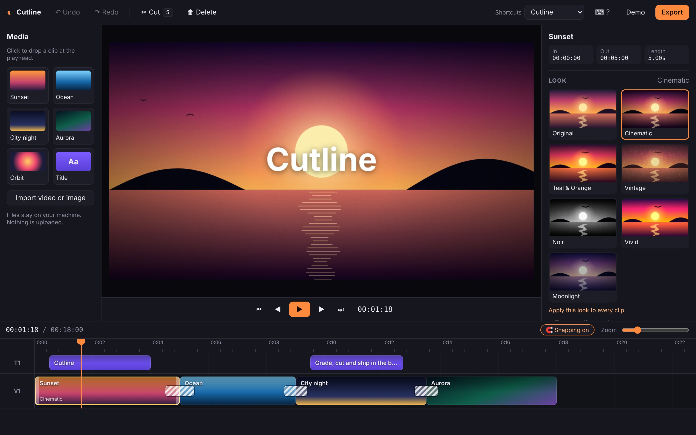

# Cutline

A small video editor that runs entirely in the browser. It focuses on three things editors care about every day: getting a good look fast, cutting precisely on a timeline, and keeping the keyboard shortcuts their hands already know.



## What it does

**Timeline**
- Move clips by dragging, trim them from either edge, cut at the playhead.
- Snapping to the playhead and to every edit point, with a guide line while you drag.
- Ripple delete or delete with a gap, undo and redo for every edit (a whole drag is one undo step).
- Zoom with the slider, the keyboard or Ctrl / ⌘ + scroll.

**Looks in one click**
- Seven grading presets (Cinematic, Teal & Orange, Vintage, Noir, Vivid, Moonlight, Original). Each preset sets eight controls at once: exposure, contrast, saturation, temperature, tint, fade, vignette and grain.
- Preset thumbnails render the selected clip's current frame, so you choose a look by seeing it.
- Fine-tune any control afterwards, or apply the same look to every clip.

**Transitions and titles**
- Cross dissolve, dip to black, slide, wipe and zoom between two clips, with adjustable duration.
- Titles with fade, rise or typewriter animations.

**Shortcuts for people coming from other editors**
- Switch between Cutline, Premiere Pro and Final Cut Pro layouts in one click (top right, or press `?`).
- Example: cut at playhead is `S` in Cutline, `Ctrl/⌘ + K` in Premiere Pro and `⌘ + B` in Final Cut Pro. In the Final Cut layout, Delete closes the gap like the magnetic timeline does.
- Click any shortcut in the sheet to rebind it. Conflicting keys are removed from the other action.
- J / K / L shuttle, frame stepping, previous and next edit point.

**Media and export**
- Five generated demo scenes, so the project works without uploading anything.
- Import your own videos and images. Files stay on your machine.
- Export the timeline to WebM in real time (Chrome, Edge, Firefox).
- The project autosaves in the browser.

## Run it

```bash
npm install
npm run dev
```

Then open http://localhost:5173.

```bash
npm run build     # type check and production build in dist/
npm run preview   # serve the production build
```

## Deploy on Vercel

Import the repository in Vercel. It detects Vite automatically: build command `npm run build`, output folder `dist`.

## How it is built

- React 19, TypeScript, Vite. No UI or video library.
- `src/lib/renderer.ts` draws one frame of the composition on a 2D canvas: active clip, transitions between adjacent clips, then titles. Rendering is a pure function of the project and the time, which is what makes scrubbing, thumbnails and export use the same code.
- `src/lib/grades.ts` applies a grade with canvas filters for exposure, contrast and saturation, then blend modes for temperature, tint, fade, vignette and grain.
- `src/state/useHistory.ts` keeps past and future project states. Drags and slider moves use a gesture so the whole interaction becomes a single undo step.
- `src/lib/keymaps.ts` defines actions once and maps them to each layout.
- Edits in `src/lib/project.ts` are pure functions on the project data.

## Limits and next steps

- One video track and one title track. Next: more tracks and drag between them.
- No audio yet. Next: audio track with waveform.
- Export runs in real time through MediaRecorder. A WebCodecs encoder would make it faster than real time and allow MP4.
- The keyboard layouts cover the most used shortcuts, not the full Premiere Pro or Final Cut Pro sets.
